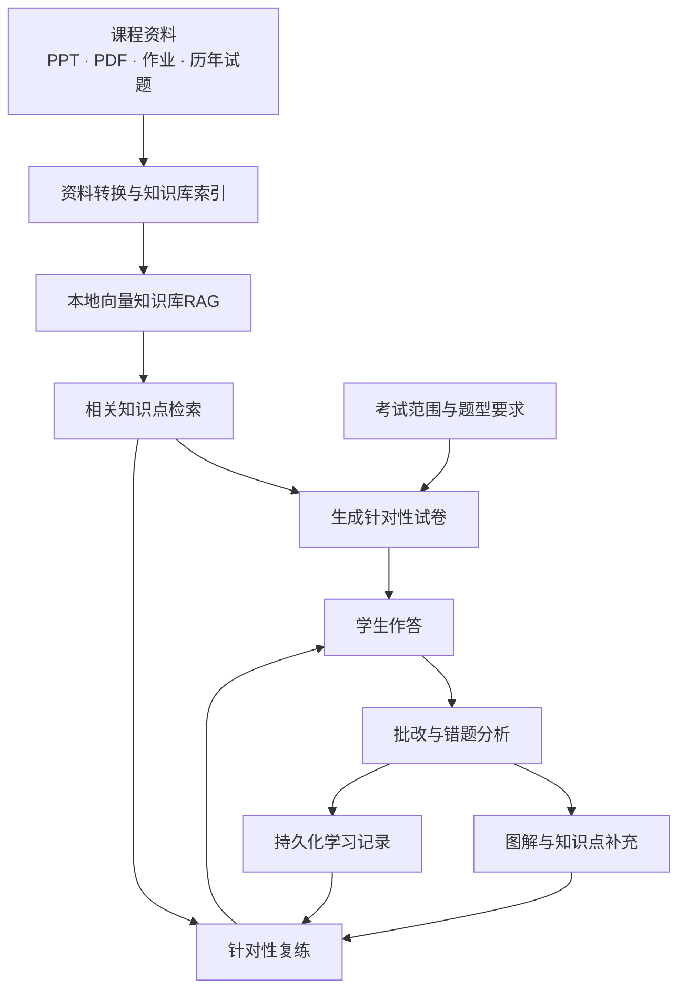

# Final Exam Review

**Turn your course materials into a personalized, continuous exam preparation workflow.**

一个面向 AI Agent 的期末考试复习 Skill，将课件、作业和历年试题转化为可检索可复用的本地课程知识库，提供针对性出题、智能批改、错题图解和持续学习追踪。


[快速开始](#快速开始) · [核心功能](#核心功能) · [工作原理](#工作原理) · [使用示例](#使用示例) · [技术文档](#技术文档)

:::
:::writing{variant="document" id="93126"}
## 快速开始

### 1. 安装 Skill

推荐使用 [Skills CLI](https://github.com/vercel-labs/skills) 安装：

```bash
npx skills add havxiaobing/final-exam-review
```

按照提示选择需要安装到的 AI Agent。

如果希望在多个项目中使用，可以进行全局安装：

```bash
npx skills add havxiaobing/final-exam-review -g
```

也可以指定目标平台，例如：

```bash
# Codex
npx skills add havxiaobing/final-exam-review -g -a codex

# Claude Code
npx skills add havxiaobing/final-exam-review -g -a claude-code

# Cursor
npx skills add havxiaobing/final-exam-review -g -a cursor

# OpenCode
npx skills add havxiaobing/final-exam-review -g -a opencode
```

使用 Skills CLI 需要提前安装符合其版本要求的 Node.js。

### 2. 安装运行依赖

建议使用 Python 3.13，并通过独立虚拟环境安装以下依赖：

```bash
python -m venv .venv
```

激活虚拟环境：

**Windows PowerShell**

```powershell
.\.venv\Scripts\Activate.ps1
```

**macOS / Linux**

```bash
source .venv/bin/activate
```

安装依赖：

```bash
python -m pip install fastembed==0.9.1 pymupdf python-pptx
```

首次准备向量模型时需要联网下载模型文件，此后可复用本地模型缓存。

也可以让 Agent 协助完成 Python 环境配置、依赖安装和模型准备。

### 3. 开始复习

启动支持 Agent Skills 的 AI Agent，调用 `final-exam-review`，或者直接使用自然语言描述你的复习需求。

例如：

> 帮我生成一份流体力学的期末模拟卷，课程资料位于 D:\学习资料\海洋流体动力学。

Skill 会根据当前课程的初始化状态，引导你确认课程目录、考试范围及备考要求，并按照 [SKILL.md](SKILL.md) 中定义的工作流程处理课程资料。


*实际运行示例：Agent 根据用户提供的课程资料，引导用户完成课程知识库与学习记录的存储配置。*

也可以一次性提供完整的复习要求：

```text
课程：流体力学
课程资料：D:/Study/FluidMechanics/materials
课程目录：D:/Study/FluidMechanics/review
考试范围：第 1–6 章
考试题型：选择题、填空题、简答题、计算题

请建立课程知识库，参考老师的作业和课件例题，
生成一份诊断性模拟试卷。
等我完成后批改，并记录薄弱知识点。
```

后续复习只需继续使用同一个课程目录，即可复用已建立的知识库和历史学习记录。

### 平台兼容性

本项目采用 [Agent Skills](https://agentskills.io/) 开放规范组织技能指令、执行脚本和参考文档，不依赖单一 AI Agent 平台。

目标支持的平台包括：

| 平台 | 兼容性 |
| --- | --- |
| Codex | 已有实际运行示例 |
| Claude Code | 待验证 |
| Cursor | 待验证 |
| OpenCode | 待验证 |
| 其他支持 Agent Skills 的平台 | 取决于平台能力 |

完整工作流程要求 Agent 具备本地文件读写、终端命令执行和 Python 脚本运行能力。交互式询问和错题图解的呈现形式可能因平台而异。

### 手动安装

如果不使用 Skills CLI，也可以直接克隆仓库：

```bash
git clone https://github.com/havxiaobing/final-exam-review.git
```

将完整的 `final-exam-review` 目录放入目标 Agent 的 Skills 目录，并保留其中的 `SKILL.md`、`scripts/` 和 `references/` 等文件。

具体技能目录及调用方式请参阅对应 Agent 的官方文档。
:::

## 工作原理

Final Exam Review 将整个复习过程划分为两个相互关联的部分：课程知识库和持续学习记录。



### 01. 建立课程知识库

将用户提供的课程资料转换为 Markdown，使用本地向量模型建立索引。

后续复习时，Skill 根据当前任务检索相关内容，而不是反复将完整课件载入上下文。

### 02. 生成符合课程要求的试卷

考试范围是出题的基本约束。出题资料按照以下优先级使用：

1. 老师布置的作业、练习题、样卷及历年试题。
2. PPT 中的例题及课程知识点。
3. 用户补充的教材和课堂笔记。
4. 符合课程范围的公开考研题。

当缺少可用的课内出题资料时，Skill 会优先询问是否能够补充教材或笔记。用户确认没有其他资料，或明确要求联网搜索后，才使用外部公开题源，并说明其与当前课程的适配程度尚未校准。

### 03. 批改与图解错题

提交作答后，默认按照以下结构提供反馈：

- **得分统计**：总分、各题得分及失分情况。
- **错题分析**：原题、实际作答中的错误、正确解法及相关知识点。
- **图解说明**：在对应错题下展示辅助理解的情景图或知识点图。
- **试卷总结**：主要知识缺口及下一阶段的复习建议。

错题分析保留该次作答对应版本的题目、选项、小问、必要数据及已保存的原题图片。

对于主要失分题，重点分析其背后的知识缺口；对于孤立的计算或书写错误，则进行简洁订正。

### 04. 持续学习与针对性复练

试卷、作答、错题及掌握情况保存在用户指定的课程目录中。

开启新对话时，可以继续使用同一课程目录，读取已有复习记录，并针对尚未掌握的知识点生成新的练习。

## 使用示例

### 建立课程知识库

> 这是老师的课件、三次作业和考试范围。请建立本地课程知识库，整理需要掌握的知识点，并区分考试重点和非考试内容。

### 生成模拟试卷

> 参考老师之前布置的作业和样卷，生成一份满分 100 分、考试时间 120 分钟的模拟试卷。不要提前展示答案。

### 批改与错题讲解

> 这是我的试卷作答。请按考试标准批改，重点解释失分原因，并为理解困难的题目绘制示意图。

### 薄弱知识点专项训练

> 根据我最近两次模拟考试的记录，找出尚未掌握的知识点，生成一组针对性练习。减少已经掌握的简单题。

### 考前冲刺

> 距离考试还有两小时。结合考试范围和历史错题，整理最需要复习的知识点，并给出几道具有代表性的例题。

## 项目结构

```text
final-exam-review/
├── SKILL.md
├── README.md
│
├── scripts/
│   ├── convert.py
│   ├── library.py
│   └── records.py
│
├── references/
│   ├── conversion.md
│   ├── vector-library.md
│   ├── records.md
│   └── testing.md
│
├── evals/
│   └── evals.json
│
└── tests/
```

| 组件 | 职责 |
| --- | --- |
| `SKILL.md` | 定义 Agent 的复习工作流程及行为约束 |
| `convert.py` | 课程资料转换 |
| `library.py` | 向量模型准备、索引构建与语义检索 |
| `records.py` | 课程档案、试卷、作答及学习记录管理 |
| `references/` | 详细工作流程、命令和数据格式说明 |
| `evals/` | Skill 对话场景评估 |
| `tests/` | 自动化回归测试 |

## 高级配置

通常可以直接通过 Codex 使用本 Skill，无需手动执行内部脚本。对于需要自行管理知识库或调试的用户，也可以使用以下命令。

以下命令在 Skill 根目录运行，`python` 表示已安装依赖的虚拟环境中的 Python。

### 初始化课程档案

最小课程档案示例：

```json
{
  "course": "流体力学",
  "scope": "第 1–6 章"
}
```

将档案保存为 UTF-8 编码的 JSON 文件，然后运行：

```text
python -X utf8 scripts/records.py --course-dir "<课程目录>" init --file "<课程档案JSON路径>" --confirm-storage
```

### 转换课程资料

```text
python -X utf8 scripts/convert.py --course-dir "<课程目录>" "<课件文件路径>"
```

### 准备向量模型

```text
python -X utf8 scripts/library.py --course-dir "<课程目录>" prepare-model --model "<模型缓存目录>"
```

### 构建索引

```text
python -X utf8 scripts/library.py --course-dir "<课程目录>" index --model "<模型缓存目录>"
```

### 检索知识点

```text
python -X utf8 scripts/library.py --course-dir "<课程目录>" search --query "<知识点>"
```

上述路径建议使用绝对路径。

课程目录、模型缓存及虚拟环境建议独立于 Skill 源码仓库，以便在更新 Skill 时保留已有课程资料和学习记录。

迁移已有课程目录后，需要在新位置重新确认存储路径：

```text
python -X utf8 scripts/records.py --course-dir "<新课程目录>" confirm-storage
```

该命令要求当前位置已有有效课程档案。迁移模型缓存后，需使用新的模型路径重新构建索引。

## 技术文档

| 文档 | 内容 |
| --- | --- |
| [SKILL.md](SKILL.md) | Skill 工作流程与行为规范 |
| [资料转换](references/conversion.md) | 文件转换、图片、图表和公式处理 |
| [向量知识库](references/vector-library.md) | 模型管理、索引构建、检索及来源定位 |
| [学习记录](references/records.md) | 课程档案、试卷及作答的数据格式 |
| [测试说明](references/testing.md) | 自动测试、人工验收与发布验证 |

## 数据与隐私

Final Exam Review 采用本地存储和本地向量检索设计。

- 课程资料转换结果、向量索引及学习记录保存在用户指定的目录中。
- 安装依赖和首次准备向量模型时需要联网。
- 向量索引构建和检索使用本地模型缓存。
- 在符合外部题源使用条件时，Skill 可能联网检索公开资料。
- AI 助手处理检索结果的方式取决于所使用的平台及相关数据配置。

本地知识库并不意味着整个 AI 推理过程完全离线。若资料私密请注意保护隐私。

## 已知限制

- 扫描版 PDF、复杂公式、工程图和课件中的嵌入图片可能需要人工核对。
- 向量检索结果可能存在遗漏，不能完全替代对重要原始资料的检查。
- 生成试题和批改结果的质量取决于资料完整程度及所使用的 AI 模型。
- 外部公开试题不一定完全符合所在学校的教学内容和考试风格。

本 Skill 用于辅助复习，不替代教材、教师提供的标准答案或正式考试评价。

## 测试

在 Skill 根目录运行自动化测试：

```text
python -X utf8 -m unittest discover -s tests -v
```

对话评估用例见 [evals/evals.json](evals/evals.json)。

人工验收及发布前检查见 [测试说明](references/testing.md)。

## 第三方组件

- [FastEmbed](https://github.com/qdrant/fastembed) — 本地文本向量化。
- [PyMuPDF](https://github.com/pymupdf/PyMuPDF) — PDF 文档处理。
- [python-pptx](https://github.com/scanny/python-pptx) — PowerPoint 文档处理。

PyMuPDF 的发布方提供 AGPL 和商业许可，详见 [PyMuPDF License](https://pymupdf.readthedocs.io/en/latest/about.html#license-and-copyright)。

向量模型权重在首次准备时单独下载，并遵循对应模型的许可条款。

---

**Study from your materials. Learn from your mistakes. Improve with every attempt.**
:::
